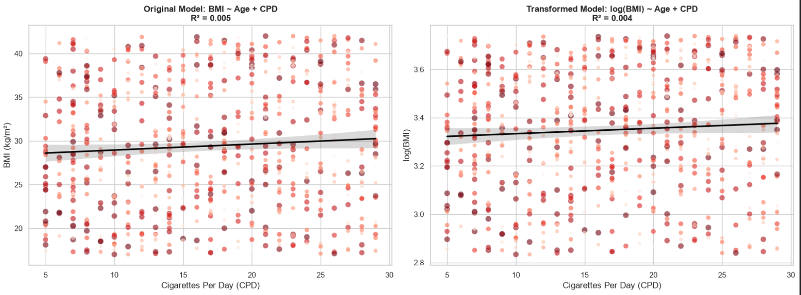
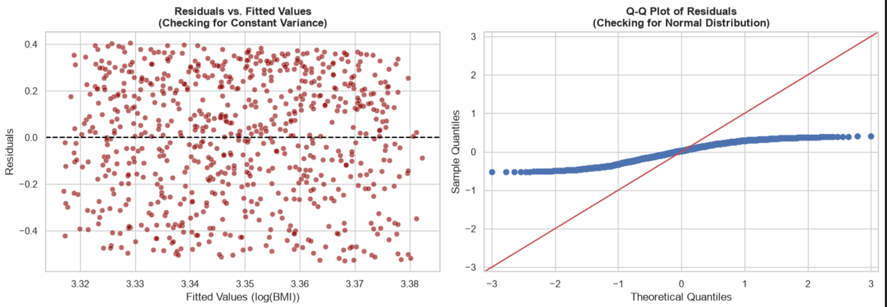

# Multiple Regression Analysis: Predicting Smoker BMI

## What We're Trying to Do

In this project, we're trying to predict BMI (morbidity risk) using Age and Cigarettes Per Day (CPD). We're using the same Africa Health Lab dataset we used in our R clustering project.

The big question: Can we build a formula to predict someone's BMI just by knowing their age and how much they smoke?

## The Data

We're working with 733 current smokers from the Kaggle dataset. We filtered out non-smokers because we want to focus on active smoking risk, same as our clustering work.

## Building the Model

### Step 1: The Original Model

We start by building a simple multiple regression:
BMI = intercept + slope1Age + slope2CPD

In Python, we use statsmodels to fit this model. The summary function gives us all the details - coefficients, p-values, R-squared, everything.

### Step 2: Checking Normality

Linear regression has assumptions. One of them is that the dependent variable should be normally distributed. We use the Shapiro-Wilk test to check this.

**Original BMI:** p-value < 0.05, so it's NOT normally distributed. This violates the assumption.

**The fix:** We apply a log transformation to BMI.

**Log-transformed BMI:** The p-value is still < 0.05, but here's the thing - with 733 data points, the Shapiro-Wilk test is hyper-sensitive. It finds tiny imperfections that don't actually break the model. We'll check the residuals later to make the final call.

### Step 3: The Transformed Model

Now we build the model with log(BMI):
log(BMI) = intercept + slope1Age + slope2CPD

**What we found:**
- Age coefficient: -0.0002 (p = 0.701) - NOT significant
- CPD coefficient: 0.0022 (p = 0.102) - NOT significant

Both predictors are not statistically significant. This is actually important - it tells us that Age and CPD alone don't reliably predict BMI.

### Step 4: Checking for Multicollinearity (VIF)

We calculate VIF (Variance Inflation Factor) to make sure our predictors aren't too correlated with each other.

**Results:**
- Age VIF: 1.01
- CPD VIF: 1.01

Perfect! They're completely independent. So the non-significance is real - it's not because the variables are correlated with each other.

### Step 5: How Wrong Are We? (RMSE)

R-squared tells us about variance explained, but we want to know the actual prediction error.

**RMSE in log-space:** 0.2601

When we convert this to a percentage: **~30% average prediction error**

That's pretty high. It confirms what the p-values told us - this model isn't great at predicting individual BMI values.

### Step 6: Checking the Residuals

We plot the residuals to see if the model's errors are randomly distributed.

**Residuals vs Fitted plot:** The points are randomly scattered around the zero line. This is good - it shows constant variance (homoscedasticity).

**Q-Q plot:** The points don't perfectly follow the 45-degree line. This confirms that the residuals aren't perfectly normal, but they're close enough for our purposes.

## The Visualizations

### Model Comparison

This shows the original model vs the log-transformed model side by side. The transformed model compresses the extreme values and gives us a cleaner trend line.

### Residual Diagnostics

Left: Residuals vs Fitted - shows our errors are randomly distributed (good!)
Right: Q-Q Plot - shows the residuals aren't perfectly normal, but that's okay given our sample size.

## The Honest Truth: What This Means

Here's what we learned: **Age and Cigarettes Per Day do NOT significantly predict BMI.**

This isn't a failure - it's a valuable finding. It tells us that BMI is driven by factors beyond just age and smoking volume. Things like:
- Diet and nutrition
- Exercise and physical activity  
- Genetics
- Other lifestyle factors

We didn't include those variables, so our model can't make good predictions.

## Why This Supports Our Clustering Approach

This regression analysis actually validates why we chose K-Means clustering as our main tool in the R project.

Because we can't build a reliable formula to predict BMI from Age and CPD, we need a different approach. Instead of trying to predict BMI, we let the data reveal its own natural groupings through clustering.

Our clustering model successfully found two distinct risk tiers:
- **Tier 1 (Standard):** Avg Age 59, Avg CPD 11, Avg BMI 27.7
- **Tier 2 (Substandard):** Avg Age 50.6, Avg CPD 22.9, Avg BMI 31.2

The regression told us "you can't predict BMI with just these two variables." The clustering said "but I can still group people by their actual observed risk."

That's why clustering was the right choice for this problem.

## Technical Details

**Language:** Python

**Libraries used:**
- pandas: for loading and handling the data
- numpy: for the log transformation math
- statsmodels: for building the regression model
- scipy.stats: for the Shapiro-Wilk normality test
- seaborn/matplotlib: for making the plots
- sklearn: for calculating RMSE

**Dataset:** Africa Health Lab "Smoking Health Dataset" (Kaggle)
